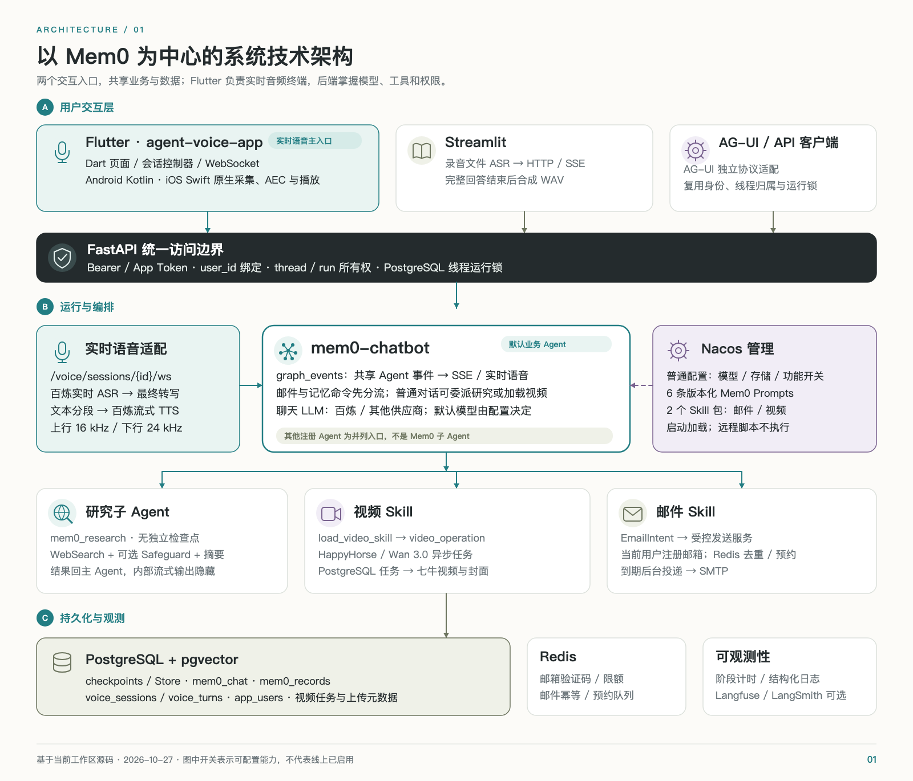
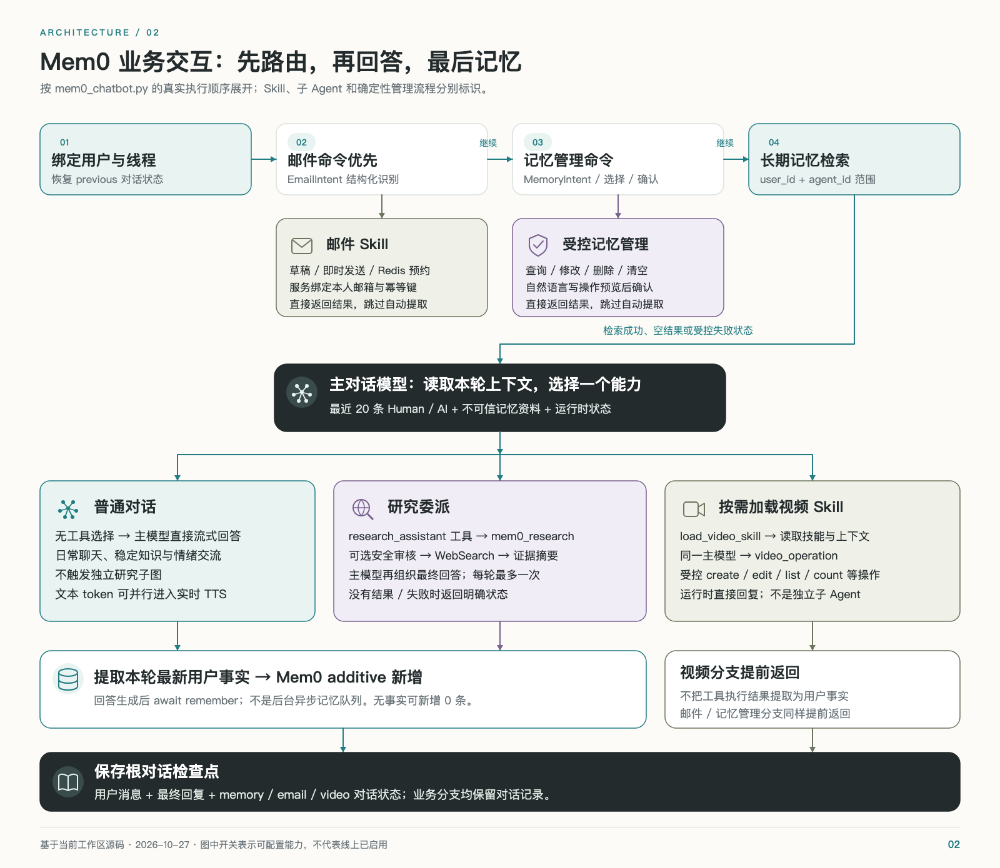
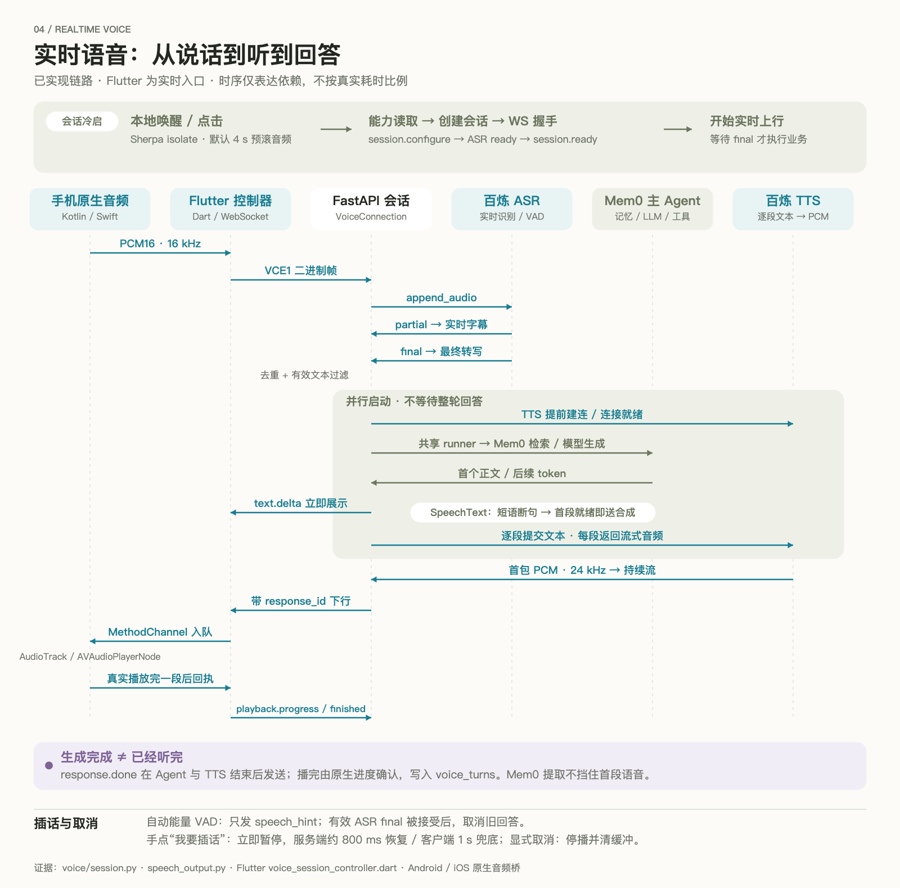

# Mem0 智能体与实时语音架构

基于 **Flutter · FastAPI · LangGraph · Mem0 · PostgreSQL/pgvector** 的持续语音对话系统。

用户的声音经实时 ASR 转为有效输入，由 `mem0-chatbot` 召回长期记忆、处理业务或委派研究，再将根回答流式送往界面与分段 TTS。手机负责真实播放与回执，后端分别保存完整对话、长期事实和语音轮次状态。

[Mem0 业务流程](#mem0-业务交互流程) · [实时语音时序](#实时语音全链路时序) · [记忆与对话](#记忆提取与对话记录) · [延时观测](#首字首包与实际出声的延时) · [完整专题文档](docs/architecture/README.md) · [飞书知识库](https://k0ddd9qp4r.feishu.cn/wiki/OMg9wT217iHU1EkxWOScqkqNnJb)

> 源码核验日期：2026-10-27。本文描述当前实现；功能开关、模型和音色受 Settings 与 Nacos 配置控制，默认值不代表线上实际配置。长期记忆默认关闭，启用后接入下述提取与召回流程。

## 技术架构与职责



[放大查看 / 可编辑 SVG](docs/architecture/assets/01-system-architecture.svg)

| 层次 | 技术与组件 | 在 Mem0 与语音链路中的职责 |
| --- | --- | --- |
| 手机交互 | 独立项目 `agent-voice-app`，Flutter/Dart | 登录、会话、字幕、记忆与历史页面；通过 HTTP 与 WebSocket 连接后端 |
| 原生音频 | Android AudioRecord/AudioTrack；iOS AVAudioEngine/AVAudioPlayerNode | 采集、回声处理、音频路由、播放队列与真实分段完成回执 |
| 唤醒 | Sherpa ONNX、本地关键词模型、Dart isolate | 前台唤醒与预滚缓冲；后端 ASR 再确认唤醒词 |
| 接入与调度 | Python 3.12–3.14、FastAPI、Pydantic、asyncio | 身份绑定、线程授权、语音协议、队列背压、取消与资源释放 |
| 主对话 | LangGraph `mem0_chatbot`、共享 `graph_events()` | 恢复对话、业务分流、工具调用与根回答流式输出 |
| 长期记忆 | Mem0 SDK、提取 LLM、Embedding、可选 Reranker | 提取用户事实、跨线程召回、受控修改删除与变更历史 |
| 语音供应商 | 百炼 ASR/TTS，realtime/inference 适配器 | 持续识别、VAD、分段合成与 PCM 流；与聊天模型分别调用 |
| 持久化 | PostgreSQL、pgvector、LangGraph checkpointer | 完整对话、事实向量、提取参考、事实变更历史和语音状态 |
| 业务与配置 | Redis、SMTP、视频服务、七牛、Nacos | 邮件去重/预约、视频异步任务与存储；启动时加载配置、Prompt 和 Skill |

HTTP、SSE、AG-UI 和实时语音入口共用身份与线程约束。实时语音在后端内部调用共享 Agent 事件层，不需要再绕一遍 HTTP SSE。

## Mem0 业务交互流程



[放大查看 / 可编辑 SVG](docs/architecture/assets/02-mem0-business-flow.svg) · [完整 Agent 与记忆说明](docs/architecture/Mem0_Agent_and_Memory.md)

### 一轮请求如何执行

1. **绑定用户与线程。** 服务校验身份和线程归属，恢复 LangGraph checkpoint 中的完整消息及待确认业务状态；语音输入与文字输入进入同一个 `mem0-chatbot`。
2. **先处理邮件，再处理记忆命令。** 有相关线索或待补充/确认状态时，执行结构化识别与受控流程；分支返回后保存对话，不再进入普通聊天的自动事实提取。
3. **召回用户长期事实。** 按 `user_id + agent_id` 检索，作为标有 `untrusted_user_memories` 的参考加入提示；最近 20 条 Human/AI 消息供主模型对话，完整历史仍保留在 checkpoint。
4. **由主模型选择能力。** 可以直接回答、委派一次联网研究，或按需加载视频 Skill 后执行操作。研究内部规划、工具参数和子图正文被事件层隐藏，只有根回答进入 UI 与 TTS。
5. **边生成边展示与合成。** 根正文 token 产生 `text.delta`，同时进入 TTS 文本队列；首个短语就可以合成和播放，无需等待完整回答。
6. **保存事实与线程。** 普通/研究回答后，Agent 等待 `remember()` 提取最新用户输入中的事实，再返回最终状态；视频结果分支提前保存，不走自动提取。实时播报可与这段提取重叠，提取耗时仍可能延后轮次完成。

### Skills、子 Agent 与模型步骤

| 能力 | 实现与触发 | 与主 Agent 的关系 |
| --- | --- | --- |
| 日常对话 | `mem0_chatbot` + 当前选择的聊天模型 | 主 Agent 本身 |
| 联网研究 | `research_assistant` 工具 → `mem0_research` task → `research_subagent` | 真正的 LangGraph 子图；每轮最多一次，搜索后摘要，再由主模型回答 |
| 邮件 Skill | `send-current-user-email`、`handle_email_command`、`EmailSkillService` | 结构化意图识别与确定性业务流程；收件人绑定当前注册用户 |
| 视频 Skill | `manage-user-videos`、`VideoSkillSession`、`VideoService` | 同一主模型先 `load_video_skill`，再 `video_operation`；生成任务异步完成 |
| 记忆管理 | `MemoryIntent`、`MemoryMatch`、`MemoryDialogue` | 候选选择、预览、确认与并发复核组成的受控流程 |
| 事实提取 | Mem0 SDK + 提取模型 + Embedding | 记忆组件调用；不承担独立多轮对话 |

邮件与视频两种应用 Skill 从 Nacos 在启动时加载。仓库维护、飞书发布等开发工具 Skill 不属于应用运行时能力。研究子图使用受限搜索与摘要能力，无独立持久会话 checkpoint；它与独立注册的 `research-assistant` 工具集合不同。

业务完成与语音完成有各自状态：邮件的 SMTP 接受、视频的任务提交或成片、TTS 合成和手机播放分别确认。取消语音不会撤回已提交的外部业务。

## 实时语音全链路时序



[放大查看 / 可编辑 SVG](docs/architecture/assets/04-voice-sequence.svg) · [完整语音链路与延时说明](docs/architecture/Voice_End_to_End.md)

### 从用户说话到听见回答

| 阶段 | 交互与事件 | 关键实现 |
| --- | --- | --- |
| 01 / 会话就绪 | 获取 `/voice/capabilities` → `POST /voice/sessions` → WebSocket → `session.configure` → `session.ready` | App 显式选择 `mem0-chatbot`；ASR 上游就绪后才开放持续上传 |
| 02 / 终端采集 | 原生 PCM → EventChannel → Dart → 上行二进制帧 | 16kHz、PCM16、单声道；Android 约 40ms 采集块；唤醒可补传预滚音频 |
| 03 / 实时识别 | `upload()` 写 ASR；`recognize()` 读 partial/final | partial 用于字幕；有效 final 经去重、唤醒词处理后提交 Agent，常规 Flutter 路径使用 server VAD |
| 04 / 接受输入 | `submit()` → 保存 VoiceTurn → `input.accepted` → worker | `input_id` 幂等；检查队列容量；新有效输入使旧响应失效 |
| 05 / 并发准备 | `execute()` 同时启动 `generate()` 与 `speak()` | Agent 恢复线程并发送 `response.started`；TTS 独立预建连接并等待文本 |
| 06 / Agent 首字 | Mem0 业务分流/召回 → 主模型根正文 → `text.delta` | UI 展示文字，正文同步进入有界 TTS 队列；内部研究与规划不播报 |
| 07 / 分段合成 | `SpeechText` 清洗断句 → `audio.segment.started` → TTS PCM | 首段最多 24 字符/约 180ms 刷出，后续最多 160 字符/约 400ms；也按可用标点边界刷出 |
| 08 / 音频下行 | `emit_audio()` → outgoing 队列 → WebSocket 二进制帧 | 24kHz、PCM16、单声道；连接、响应、分段与序号用于有序处理和过滤旧帧 |
| 09 / 真实播放 | Dart 解码 → MethodChannel → 原生播放器 | 首包入队之后仍受原生缓冲、硬件和音频路由影响；收到音频不等于实际出声 |
| 10 / 回执与落库 | `playback.progress` / `playback.finished` → VoiceRepository | 记录确认播完的分段与采样；Agent 与 TTS 结束后的 `response.done` 不代表设备已排空 |

传输使用控制 JSON 与音频二进制帧混合的双向 WebSocket。音频帧为 `VCE1`、45 字节头加 PCM，单帧 payload 上限 6400 字节；协议和事件约定见 [Voice API](docs/Voice_API.md)。

`/voice/capabilities.default_agent` 为 `mem0-chatbot`，但创建会话 schema 的 `agent_id` 默认仍是 `chatbot`。自行调用接口时应显式传 `agent_id: "mem0-chatbot"`，Flutter 正常路径会提交所选值。

### 插话、取消与已听上下文

- **自动检测到说话：** 端侧能量提示不立即暂停播放；ASR 的有效 final 被后端接受后，才取消上一响应。噪声、空白和无效转写不会直接重启 Agent。
- **点击“我要插话”：** 手机立即暂停并保留缓冲，后端等待有效输入；未确认时走恢复提示与终端兜底。
- **显式取消：** 手机停播清缓冲，后端使响应失效并取消可取消任务；双方继续丢弃迟到的旧响应音频。
- **继续对话：** 下一轮 `delivery_context()` 只引用完整且确认播完的分段，避免将只生成过的内容视为已听上下文。

### Streamlit 的语音路径

Streamlit 提交完整录音，由同步 HTTP ASR 识别，再通过 `AgentClient.astream()` 接收 SSE 文字；流结束后对完整回答做整段 TTS。它与 Flutter 持续 PCM、分段播报、播放回执的路径不同，延时应分别统计。

## 记忆提取与对话记录

主 Agent 通过 Mem0 使用长期事实；对话恢复、事实召回与播放确认由不同数据层承担。

| 数据 | 存储与范围 | 用途 |
| --- | --- | --- |
| 完整对话 | PostgreSQL LangGraph checkpoint；按线程授权 | 保存用户与助手消息、业务状态，支持恢复和继续聊天 |
| 主模型窗口 | 每轮临时构造的最近 20 条 Human/AI 消息 | 控制模型上下文；截取窗口不会删除历史 |
| 长期事实 | Mem0 SDK + pgvector；按用户与 Agent 隔离、跨线程召回 | 个性化回答，来源线程作为 metadata |
| 提取参考与变更历史 | PostgreSQL `mem0_records` | 近期指代参考、ADD/UPDATE/DELETE 审计与 owner 校验 |
| 语音轮次与播放 | `voice_turns.data` | 保存文本、分段、采样和播放确认；不保存原始 PCM |

事实写入路径为 **最新用户消息 → 近期参考消歧 → 检索已有事实 → 提取模型结构化 JSON → 校验 → Embedding → 去重 → pgvector 与 ADD 历史**。近期 Human/AI 消息用于指代消解；研究摘要不会作为用户新事实来源。

当前固定 Mem0 SDK 2.2.1 的自动提取采用新增策略，不会自动 UPDATE/DELETE 旧事实。自然语言修改、删除和清空要经过意图识别、候选定位、预览、明确确认和锁内复核；Flutter 的 REST 管理接口有独立表单确认与服务端所有权校验。

召回默认取前 5 条、阈值 0.3，启用外部 Reranker 时先扩展候选再重排；事实参考默认受 6000 字符预算限制。参考带有非可信数据标签，不能覆盖系统指令。完整机制见 [记忆生命周期图](docs/architecture/assets/03-memory-lifecycle.svg) 与 [Mem0 专篇](docs/architecture/Mem0_Agent_and_Memory.md)。

## 首字、首包与实际出声的延时

**首字符、首音频包、扬声器实际首声有不同测量边界。** Agent 与 TTS 连接并发准备，文字生成、合成和播放也可以重叠，不能把各阶段累计指标直接相加。

| 服务端指标 | 起点 → 终点 | 说明 |
| --- | --- | --- |
| `first_text_ms` | `accepted` → 首个根正文 | 包含轮次持久化、排队和 Agent 准备；不含之前的 ASR |
| `tts_ready_ms` | `accepted` → TTS 连接上下文就绪 | 与 Agent 并行；realtime 与 inference 的就绪含义有差异 |
| `first_speech_ms` | `accepted` → 首个可朗读短语产出 | 此时不等于供应商已接收或合成音频 |
| `first_audio_ms` | `accepted` → 首 PCM 进入后端下行生产 | 包含文本聚合及合成等待；尚未经过完整发送链路 |
| `first_audio_sent_ms` | `accepted` → 首 PCM 成功交给 WebSocket | 包含发送队列等待；不含手机接收和硬件起播 |
| `text_to_audio_ms` | 首正文 → 首 PCM | 是多个步骤的综合等待，不是纯 TTS 模型耗时 |

```text
用户停说 → 首字符
  = 停说到 ASR final / submit 接受
    + 服务端 first_text_ms
    + 文字下行与终端呈现等待

用户停说 → 实际首声
  = 停说到 ASR final / submit 接受
    + 服务端 first_audio_sent_ms
    + 音频下行 + Dart/原生队列 + 硬件与路由起播
```

Flutter 已记录收到 `response.started` 后的首字、首音频包，以及 native enqueue 耗时。这个起点晚于服务端 `accepted`，两端同名字段不能直接混算；enqueue 返回也不代表扬声器出声。

当前尚缺同轮端侧话音结束与首渲染/声学首声的完整观测，**停说到真实首声的 P50/P95 待真机测量**。首段约 180ms 是文本缓冲策略，不能作为端到端语音延时承诺。测量边界、历史样本与补测方案见 [延时观测图](docs/architecture/assets/05-voice-latency.svg) 和 [语音专篇](docs/architecture/Voice_End_to_End.md)。

## 核心代码与完整资料

| 模块 | 入口 |
| --- | --- |
| 主 Agent 与研究委派 | [mem0_chatbot.py](src/agents/mem0_chatbot.py)、[research_delegation.py](src/agents/research_delegation.py) |
| 记忆服务与 SDK 适配 | [mem0_service.py](src/memory/mem0_service.py)、[mem0_sdk.py](src/memory/mem0_sdk.py)、[mem0_history.py](src/memory/mem0_history.py) |
| 记忆管理、邮件与视频 | [memory_commands.py](src/agents/memory_commands.py)、[email_commands.py](src/agents/email_commands.py)、[video_chat.py](src/skills/video_chat.py) |
| 共享执行与鉴权 | [agent_runner.py](src/service/agent_runner.py)、[access.py](src/service/access.py) |
| 语音接入、会话与断句 | [voice.py](src/service/voice.py)、[session.py](src/voice/session.py)、[speech_output.py](src/voice/speech_output.py) |
| 语音供应商、协议与持久化 | [providers/](src/voice/providers/)、[schema/voice.py](src/schema/voice.py)、[persistence.py](src/voice/persistence.py) |
| 运行配置与技能加载 | [settings.py](src/core/settings.py)、[nacos.py](src/service/nacos.py)、[skills.py](src/core/skills.py) |
| Flutter 客户端 | 相邻 `agent-voice-app` 项目的 `voice_session_controller.dart`、`audio_bridge.dart`、Android `MainActivity.kt` 与 iOS `VoiceAudioEngine.swift` |

完整文档：[技术架构总览](docs/architecture/README.md) · [Mem0 Agent 与记忆](docs/architecture/Mem0_Agent_and_Memory.md) · [语音链路与延时](docs/architecture/Voice_End_to_End.md) · [跨项目源码与测试索引](docs/architecture/Source_Map.md)。

在线与离线：[飞书 AI 知识库专题](https://k0ddd9qp4r.feishu.cn/wiki/OMg9wT217iHU1EkxWOScqkqNnJb) · [知识库分类导航](docs/architecture/Wiki_Index.md) · [离线 HTML 图册](docs/architecture/Architecture_Atlas.html) · [图稿与文档下载包](docs/architecture/Mem0_Architecture_Package.zip)。
