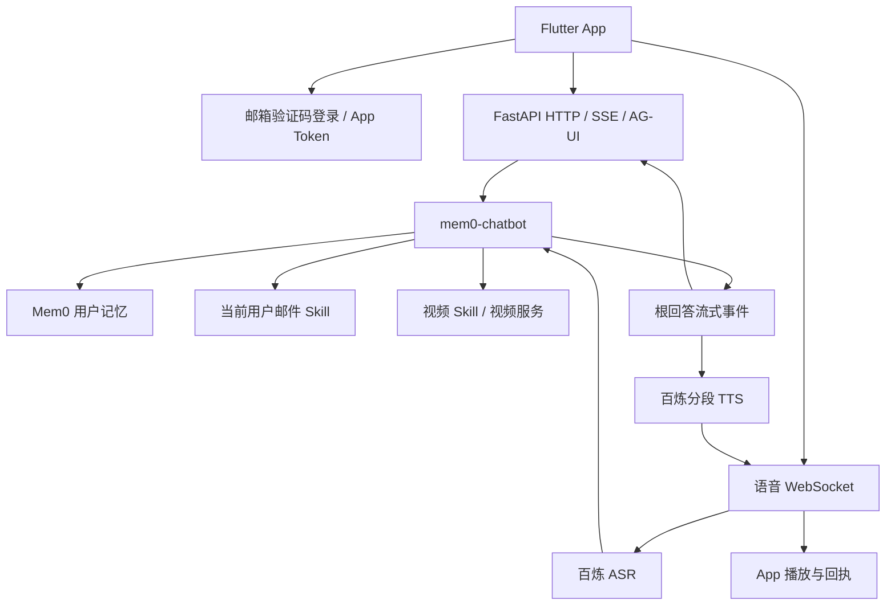

# Agent Voice Server

基于 **FastAPI · LangGraph · Mem0 · PostgreSQL/pgvector** 的对话与实时语音后端，为 [Agent Voice App](https://github.com/coderpwh1024/agent-voice-app) 和 Streamlit 客户端提供服务。

后端仓库为 [agent-voice-server](https://github.com/coderpwh1024/agent-voice-server)，与前端 `agent-voice-app` 位于相邻目录。克隆后端后进入同名目录运行：

```sh
git clone git@github.com:coderpwh1024/agent-voice-server.git
cd agent-voice-server
```

项目原名为 `agent-service-toolkit`。为兼容现有部署，Nacos 的 `agent-service-toolkit.yaml` Data ID、服务注册名、缓存目录和 PostgreSQL application name 继续使用原值；登录令牌的签发者与受众也保持原协议，无需迁移配置中心或重新登录。Compose 显式保留原项目名 `agent-service-toolkit`，继续使用现有 PostgreSQL、Redis 数据卷；已有 `-p` 或 `COMPOSE_PROJECT_NAME` 配置仍优先。新生成的部署包与安装目录示例使用 `agent-voice-server`，systemd 单元名和服务账号沿用原值；已有 Linux 部署升级前需按实际安装路径调整单元文件。

项目只运行一个 Mem0 主 Agent，内部实现为 `mem0_chat`，现有对外标识 `mem0-chatbot` 保持不变。它负责日常对话、用户长期记忆、邮件 Skill 和视频 Skill；研究、RAG、Supervisor、GitHub MCP 及 `chatbot` 的独立实现和注册均已移除。旧 `chatbot` 请求值只在 API 边界解析到主 Agent，已有 App 无需修改 URL 或参数。

## 请求与语音链路



文字与语音共用身份绑定、线程授权、模型选择和 LangGraph 检查点。语音直接调用共享 Agent 事件层，不需要再请求 HTTP SSE。

一轮有效输入按以下顺序处理：

1. 校验用户身份与线程归属，恢复历史和待处理业务状态。
2. 优先处理邮件请求与记忆管理指令。
3. 召回当前用户的长期事实，将其作为不可信参考传给主模型。
4. 主模型直接回答，或按需加载视频 Skill 后执行一次受控操作。
5. 根回答流式发送到 UI；实时语音同时断句、合成 PCM 并下发播放。
6. 普通聊天等待 Mem0 提取本轮用户事实后完成。邮件和视频分支保留原有提前返回与业务状态。

视频生成、SMTP 接受、TTS 合成与手机播放分别确认。取消语音不会撤回已提交的邮件或视频任务。

## FastAPI 结构

参考 `aigc-platform` 的分层职责，结合当前 psycopg、LangGraph、Mem0 和实时语音实现组织代码，没有引入 ORM、改表或增加 `/api/v1` 等接口前缀。

```text
app/
├── main.py             应用组装
├── lifecycle.py        启动、关闭与资源管理
├── __main__.py         python -m app 启动入口
├── api/                路由、依赖、异常响应与 WebSocket 连接
├── services/           业务流程、模型、记忆、Skill、ASR/TTS 和供应商调用
├── repositories/       PostgreSQL、Redis 和 Mem0 审计数据访问
├── models/             持久化记录与原有 SQL 定义
├── schemas/            Pydantic 请求、响应和事件契约
├── agents/             唯一 Mem0 Agent 及其编排
└── core/               配置、Nacos、模型工厂、日志与基础设施
client/                 Python 客户端与 Streamlit 语音适配
streamlit_app.py         开发聊天界面
```

| 目录 / 入口 | 职责 |
| --- | --- |
| `app/__main__.py` | Uvicorn 启动与日志配置 |
| `app/main.py`、`app/lifecycle.py` | FastAPI 组装、统一异常处理注册与共享资源生命周期 |
| `app/api/chats.py`、`app/services/chat.py` | 对话路由、SSE 封装与模型运行配置、调用服务 |
| `app/api/` | 按业务划分的认证、用户、语音、记忆、邮件、视频、文件、AG-UI 路由 |
| `app/api/dependencies.py`、`app/api/errors.py` | 认证依赖、旧请求值兼容与业务异常到 HTTP 的映射 |
| `app/services/auth.py`、`app/services/email_auth.py`、`app/services/users.py` | 令牌与线程授权、验证码登录、用户资料业务 |
| `app/repositories/` | 用户、文件、视频、语音、验证码和 Mem0 审计数据访问 |
| `app/models/` | 视频持久化记录和 `sql/` 中原有四份数据库定义，继续使用 psycopg |
| `app/schemas/` | Pydantic 请求、响应、语音事件与业务数据契约 |
| `app/agents/mem0_chat.py` | 唯一主 Agent；历史、记忆与业务分流 |
| `app/agents/chat.py` | 主模型调用、提示词上下文与按需视频技能加载 |
| `app/services/skills/` | 邮件与视频 Skill 的受控执行 |
| `app/api/voice_connection.py`、`app/services/voice/` | WebSocket 会话、ASR/TTS 供应商、断句与播放协调 |
| `app/services/memory/`、`app/core/database.py` | Mem0 SDK、长期记忆服务、PostgreSQL 检查点与 Store |
| `app/services/video/` | 视频生成、编辑、异步状态同步与七牛归档 |
| `app/core/` | Settings、模型工厂、日志、模型调用指标与 Skill 定义 |
| `client/`、`streamlit_app.py` | Python 客户端与开发聊天界面 |

服务启动先加载 Nacos 配置，再初始化 PostgreSQL、主 Agent、Mem0、邮箱认证、邮件调度、语音、视频和文件服务；退出时释放连接并取消后台任务。PostgreSQL 不可用时启动失败，不回退到其他存储。

## App 接口与兼容性

| 能力 | 现有接口 |
| --- | --- |
| 邮箱登录 / 注册 | `POST /auth/email/code`、`POST /auth/email/verify` |
| 用户资料 | `GET /users/me`、`PATCH /users/me` |
| 对话 | `POST /invoke`、`POST /stream` 及 `/{agent_id}` 版本 |
| 历史与线程 | `/history`、`/threads`、`/chat-records` 及 `/{agent_id}` 版本 |
| 实时语音 | `/voice/capabilities`、`/voice/protocol`、`/voice/sessions` 与会话 WebSocket |
| 邮件 Skill | `POST /skills/email/send` 与主 Agent 的文字 / 语音调用 |
| 视频制作与管理 | `/videos` 现有创建、列表、详情、修改、删除接口与视频 Skill |
| 文件与记忆 | `/files`、`/memories` 现有接口 |
| AG-UI | `POST /agui/run`、`POST /agui/{agent_id}/run` |

保留这些接口的路径、方法、参数、默认值、响应 schema 和 operation ID。SSE、WebSocket、音频帧、输入去重、回压、插话取消、播放确认和所有权校验沿用原实现。

`tests/contracts/` 保存调整目录前的 OpenAPI 和客户端语音事件 schema，测试会逐项比较，防止内部目录变化影响前端协议。业务层与仓储层的依赖方向由 `tests/core/test_architecture.py` 检查。

`/info` 与 `/voice/capabilities` 只列出 `mem0-chatbot`。语音创建请求的 `agent_id` 默认仍为 `chatbot`，由后端映射到同一主 Agent。继续已有线程时应继续使用该线程原来的标识，后端不改写其所有权或检查点 metadata。

其他 Agent 标识返回 404。旧数据库、历史记录与记忆不在本次收敛中删除或迁移。旧 Nacos 的研究、RAG、MCP 配置字段仍接受加载，但不能恢复已移除的能力；主 Agent 不再提供联网检索。Streamlit 和事件层保留旧历史消息的兼容展示与协议解析。

## 配置与运行

项目支持 Python 3.12–3.14，固定 uv 版本见 `deploy/uv-version`。按照 [环境配置](docs/Environment_Configuration.md) 准备 Nacos、PostgreSQL 和对应模型配置后运行：

```sh
uv sync --frozen
uv run python -m app
```

开发界面：

```sh
uv run streamlit run streamlit_app.py
```

运行时聊天、记忆 Prompt 与邮件 / 视频 Skill 由 Nacos 加载。密钥放在配置中心或忽略的环境覆盖文件中，不提交到仓库。

## 验证与文档

```sh
uv run ruff format --check .
uv run ruff check .
uv run pyrefly check
uv run pytest
./scripts/smoke_test.sh postgres agui
```

pytest 默认使用 `importlib` 收集模式，避免不同测试目录内同名文件发生模块冲突。Docker 集成测试需显式传入 `--run-docker`；真实模型、SMTP、视频与对象存储仍需相应外部服务和凭据。

冒烟脚本使用 `tests/smoke/server.py` 注入测试专用 Prompt，并关闭外部业务能力，只对接隔离的测试数据库和所选追踪服务。正式启动入口仍从 Nacos 加载 Prompt，不提供本地替代规则。

- [实时语音 API](docs/Voice_API.md)
- [Mem0 与记忆管理](docs/Mem0_Memory.md)
- [邮件 Skill](docs/Email_Skill.md)
- [视频 API 与 Skill](docs/Video_API.md)
- [用户认证与凭据边界](docs/Accounts_and_Credentials.md)
- [文件上传 API](docs/File_Upload_API.md)
- [AG-UI](docs/AGUI.md)
- [阿里云百炼](docs/Alibaba_Bailian.md)
- [Linux 部署](docs/Linux_Deployment.md) / [无 Docker 部署](docs/Linux_NoDocker_Deployment.md)
