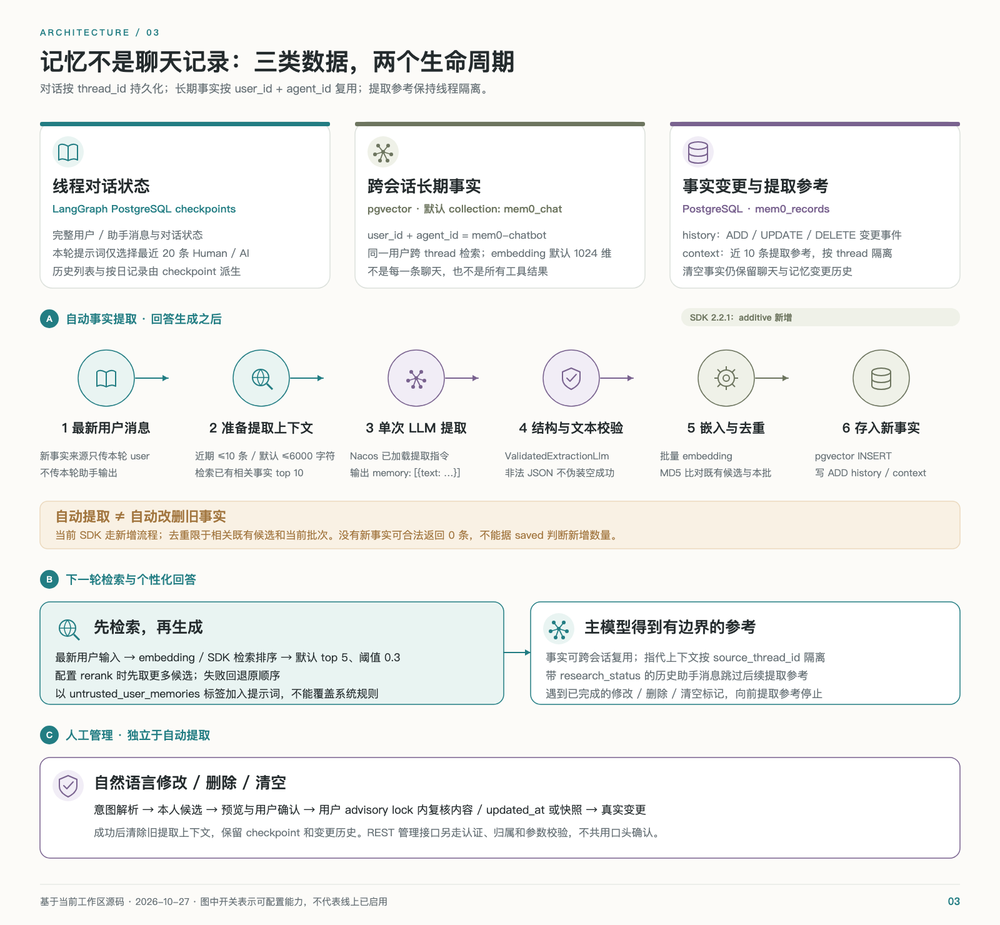

# Mem0 智能体、技能与记忆实现

核验日期：2026-10-27。适用版本：后端 `ec78ed3` + 当前工作区，固定依赖 `mem0ai==2.2.1`。本文说明现有执行和数据契约；六条远端 Prompt 的实时正文未读取，不能据此保证任意自然语言输入的提取质量。

`mem0-chatbot` 是主对话智能体，Mem0 SDK 是它使用的记忆组件。两者职责不同：主对话负责选择能力、回答和保存线程，SDK 负责用户事实的提取、检索与存储。当前 Mem0 路径真正委派的研究子图只有一个；邮件和视频是技能工作流，记忆意图识别是结构化模型步骤。

## 能力、技能、子智能体的准确关系

图源：[可编辑 SVG](assets/02-mem0-business-flow.svg)。每一轮按邮件 → 记忆命令 → 召回 → 主模型分流的顺序执行，没有所有能力并发抢答的总 supervisor。

| 能力 | 运行对象 | 加载与触发 | 是独立子智能体吗 |
| --- | --- | --- | --- |
| 日常陪聊 | `mem0_chatbot` + 当前选择的聊天模型 | 默认入口；`get_model()` 复用客户端 | 主智能体本身 |
| 联网研究 | 工具 `research_assistant` → task `mem0_research` → `research_subagent` | 默认允许研究工具；模型按问题决定，每轮最多一次 | 是；无独立持久 checkpointer 的 LangGraph 子图 |
| 邮件 | `send-current-user-email` Skill + `handle_email_command` + `EmailSkillService` | 启动从 Nacos 加载；存在待补充草稿或“邮件 + 发送”线索时识别 `EmailIntent` | 否；结构化识别加确定性业务执行 |
| 视频 | `manage-user-videos` Skill + `VideoSkillSession` + `VideoService` | 启动下载；主模型先见技能描述，选中 `load_video_skill` 后才得到完整参考与操作 schema | 否；仍由同一主模型调用 `video_operation` |
| 记忆管理 | `MemoryIntent`、`MemoryMatch`、`MemoryDialogue` | 有线索、待确认状态或明确确认时进入；识别步骤带 `skip_stream` | 否；受控管理流程 |
| 事实提取 | Mem0 SDK + 独立提取 LLM/Embedding | 普通/研究回答后调用 `remember()` | 否；记忆组件调用，不是新的会话智能体 |

仓库内 `.agents/skills`、开发者工具使用的飞书技能，以及其他维护者技能不属于应用运行时 Skill。应用当前从 Nacos 加载的这两种 Skill 名称由 `src/core/skills.py` 固定；ZIP 最多 1 MiB、最多 30 项，只接受一个受限的 `SKILL.md`，校验路径与名称，不运行远端代码。

六条默认Prompt引用如下，启动时按发布标签读取并整体校验，正文不在本地回退。修改远端发布内容后需重启应用，当前没有逐轮热拉取。

| 默认Prompt Key | 作用 |
| --- | --- |
| `mem0-chat-system` | 聊天角色、任务边界与表达规则 |
| `mem0-memory-status` | 运行时记忆状态，且仅允许一次 `{status}` 占位 |
| `mem0-memory-intent` | 管理意图提取为MemoryIntent |
| `mem0-memory-match` | 候选匹配为MemoryMatch |
| `mem0-fact-extraction-instructions` | SDK提取输入中的Custom Instructions |
| `mem0-fact-extraction-system` | 替换SDK实际提取请求的system消息 |

## 一轮主对话的顺序

1. 校验 `configurable.user_id/thread_id`，恢复 `previous.messages` 与记忆、邮件、视频对话状态。身份来自服务端绑定，不能让工具参数覆盖。
2. 获取聊天模型；`voice_enable_thinking` 优先于请求 `enable_thinking`，再使用 `CHAT_LLM_ENABLE_THINKING` 默认值。百炼聊天默认显式关闭思考，其他模型支持范围不同。
3. 执行邮件拦截。有结果就保存最终用户/助手消息及草稿状态，然后返回，不检索或自动提取长期事实。
4. 执行记忆管理拦截。需要时解析意图、定位候选、等待确认或执行管理；有结果就保存状态并提前返回。
5. 用当前最新用户输入召回长期事实，构造主模型提示：固定系统规则 → 最近对话 → 运行状态 → 标为 `untrusted_user_memories` 的参考 → 当前输入。
6. 主模型直接回复，或选择一次研究委派，或走视频“加载 → 操作”流程。带 `video_status` 的返回提前保存，不做自动提取。
7. 普通/研究回答生成后，`await memory.remember([最新用户消息], user_id, thread_id, context=近期参考)`。流式文字可能早已到达客户端；记忆提取不是放入后台队列后立刻返回。
8. 写入 `memory_status`，以 `entrypoint.final(value=本轮输出, save=完整线程状态)` 返回，由 PostgreSQL checkpointer 持久化。

证据：`src/agents/mem0_chatbot.py::mem0_chatbot`、`_chat_prompt`、`_extraction_context`；`src/agents/research_delegation.py::answer_with_research`。

## 研究子智能体

研究 task 只收到一个最长 2000 字符的独立公开查询和必要运行配置，不接收整份记忆与聊天历史。它用预置 `WebSearch` tool call 直接进入搜索，再让摘要模型整理证据，省去子图内部再次判断是否搜索的模型轮次。

子图路径为 Safeguard → WebSearch → 有证据才摘要。这个受限子图不包含计算器或天气工具；独立注册的 `research-assistant` 才提供搜索、计算器和可选天气。不能把两者的工具清单混在一起。

| 约束 | 代码行为 |
| --- | --- |
| 调用次数 | 主模型响应必须恰好选择一次已知研究工具；不执行多个并行研究调用 |
| 搜索资源 | DDGS 工作线程最多 4 个未完成请求，默认 5 秒预算；超时后的同步工作继续占用名额直到退出 |
| 总预算 | 研究子任务默认 20 秒，主模型研究最终回答另限 15 秒；不包括之前的检索和首次主模型选择 |
| 来源 | 从 WebSearch `ToolMessage.artifact` 提取，最多四条；摘要不凭空增加来源 |
| 安全审核 | 配置 Groq Key 才调用 Safeguard；未配置时跳过。受限研究路由只有 SAFE 才搜索 |
| 输出隔离 | task/namespace `mem0_research`、`skip_stream` 被共享事件层隐藏，UI 和 TTS只接收根回答 |
| 失败 | `empty/timeout/unavailable/blocked/invalid` 返回受控提示；不追加编造的联网结论 |
| 持久化 | 根历史保存用户与最终回答及来源 metadata；子图没有独立持续会话检查点 |

一次成功研究通常包含三次回答模型调用：主模型选工具、子图摘要、主模型最终回答。若启用 Groq，另加安全模型调用。失败可能提前结束；用户最终看到的首个可播报正文不一定是主模型最早返回的工具片段。

`research_status` 标记的历史助手回复被后续提取参考排除。本轮仍只把用户原始输入交给提取器，防止网页/摘要被当作用户事实；公开查询不得夹带隐私主要依靠提示词规则，并不是确定性的全内容敏感信息过滤器。

## 邮件和视频为什么单独分支

邮件是高约束操作：只有当前已认证的注册用户可发送，收件人由 `app_users` 查询；模型不能指定其他地址、CC/BCC、附件或用记忆补正文。草稿有效十分钟；未指定时间立即发送，明确未来时间只允许未来 24 小时内预约。Redis 原子脚本实现请求去重和每天十次额度，后台每秒扫描到期任务。`scheduled` 表示预约成功，`sent` 表示 SMTP 已接受，`unknown` 表示结果不确定，不能自动重发。

视频采用按需加载：主模型先选 `load_video_skill`，得到技能正文、最近最多 12 条/12000 字符的对话参考和视频草稿，再调用同一主模型生成 `video_operation`。后端校验身份、授权、参数和幂等键后执行；结果直接组织为回复，无额外最终改写模型。生成、编辑是异步任务，查询、列表、数量依赖真实业务库，不按对话猜数量。

视频通过 `agent.custom` 返回 `video.task/video.list/video.count`，同时在最终回复 metadata 中保留数据，Flutter 在实时消息和历史消息下恢复视频卡片。视频成片和封面由后端转存七牛，只有 `SUCCEEDED + STORED` 且相关元数据齐全才表示完整可用；取消语音或草稿不会撤回已提交供应商任务。

## 对话、事实和历史是三种数据

图源：[可编辑 SVG](assets/03-memory-lifecycle.svg)。完整消息供恢复对话，长期事实供跨线程个性化，`mem0_records` 的历史/参考服务于提取和审计，三者不能互相替代。

| 数据层 | 写入位置 | 读取方式 | 范围 |
| --- | --- | --- | --- |
| 完整对话 | checkpointer 中 `__previous__.messages` | `messages_from_checkpoint()`、`/history`、`/threads` | 同一线程；服务端同时校验用户和 Agent |
| 模型对话窗口 | `_chat_prompt()` 临时构造 | 仅 Human/AI 的最近 20 条，完整保留每条内容 | 不包含被裁掉的更早历史，但不删库 |
| 长期事实 | SDK pgvector collection，默认 `mem0_chat` | `memory.search()`，按用户与 `mem0-chatbot` 过滤 | 跨线程；来源 thread 只作 metadata |
| 提取参考 | `mem0_records.kind=context` / 当前显式 context | 最多十条、默认总字符预算 6000；显式 context 优先 | 按用户、Agent、source thread 隔离 |
| 事实变更历史 | `mem0_records.kind=history` | `/memories/{id}/history` | 按 memory UUID，校验活记录或历史 owner |
| 语音播放 | `voice_turns.data` | 分段文本、采样数、played_samples | 用于区分生成过与确认听过，不保存原始音频 |

`MEM0_CHAT_CONTEXT_TOKENS` 是兼容性遗留配置，当前不再限制聊天输入。20 条窗口与长期事实默认 6000 字符预算是不同限制；长记忆不会驱逐最近聊天窗口。完整对话可能持续增长，代码没有自动摘要或无限期历史压缩机制。

## 事实究竟如何提取

当前桥接保留 SDK 2.2.1 的实际算法，以 PostgreSQL `PostgresHistory` 替换其默认历史初始化，避免创建 SQLite。

1. 主智能体仅提供最新一条用户消息作为新事实来源。前文 Human/AI 只用于指代消解，例如助手问“你住在哪里”、用户回答“上海”；这段是合成示例。
2. `_extraction_context()` 从较新历史向前取最多十条/默认 6000 字符，跳过研究助手回复，遇到成功修改、删除或清空记忆的边界就停止，避免把旧提取参考重新带回。
3. SDK 为本轮消息生成查询 embedding，按 `user_id + agent_id` 取最多十条已有事实，并把 UUID 映射为短整数引用。
4. 用一次提取模型调用处理 Existing Memories、New Messages、Observation Date、Last k Messages 和 Custom Instructions。提取系统消息及项目规则来自 Nacos，而不是本地固定文本。
5. `ValidatedExtractionLlm` 校验 JSON：必须有 `memory` 列表，每条 `text` 为非空字符串；合法空列表表示没有事实，格式错误抛出异常，不能伪装成空提取成功。
6. 对事实批量 embedding；失败时 SDK 尝试逐条。对已召回事实与当前批次做文本 MD5 去重；这不是全用户库唯一约束，也不是语义重复绝对消除。
7. 新建 UUID，写入向量、正文、用户/Agent、来源线程、hash 和时间；写入 ADD 历史，并按可用情况维护 SDK 实体关联；最后保存本轮提取参考。

**自动提取采用 additive 新增，不会自动执行旧事实 UPDATE/DELETE。** 用户表达偏好变化可能成为新的事实文本；显式纠正和删除走下面的受控流程。实体关联的内部更新不等于用户事实自动更新。不能照搬通用 Mem0 示意图，声称当前提取器会自动覆盖、合并或删除全部冲突事实。

算法证据：项目 `src/memory/mem0_sdk.py`；安装的 `mem0/memory/main.py::_add_to_vector_store`、`_search_vector_store`。实体 collection 按需创建，由 SDK 管理，不是单独部署的图数据库。

提取仍属于概率性模型能力。测试中的合成场景覆盖指代、明确不记住、歧义、引用与敏感文本边界，但使用替身模型返回预设结构；它们验证数据边界和协议，不证明真实模型对所有输入都能正确提取。本次没有读取远端提示词正文或调用付费模型复测。

## 事实如何召回

查询先经过 Mem0 SDK：embedding → 过滤用户/Agent的语义候选 → PostgreSQL 全文检索及 SDK 排序/实体增强 → 阈值 → 返回结果。pgvector Provider 支持关键词搜索，SDK 用其结果构造 BM25 风格的归一化分数；其 SQL 本身使用 `ts_rank_cd`，不应称为原生 BM25 索引。

应用默认取 `MEM0_TOP_K=5`、`MEM0_THRESHOLD=0.3`。启用外部 reranker 时先请求最多 `max(top_k, MEM0_RERANK_CANDIDATES)` 条，默认候选 20，再重排取前五；SDK内部还会过取候选，不能把20说成所有数据库检索的硬上限。重排失败回退原 SDK 顺序。返回文本按 `MEM0_MAX_CONTEXT_CHARS` 截入默认 6000 字符预算。

召回事实作为有标签的 HumanMessage 参考 `{"untrusted_user_memories": [...]}` 插入，不能覆盖系统规则。没有搜索结果不等于提取没有成功；`saved` 也只表示调用成功返回，可能实际新增零条。

## 修改、删除与清空

语音和文字命令共用 `MemoryDialogue`：意图识别 → 候选检索/结构化匹配 → 多候选先选择 → 预览具体操作 → 五分钟内明确确认 → 加用户锁复核 → 执行。选中对象含 UUID、原文与 `updated_at`；清空使用全量 snapshot revision，确认时变化则返回 conflict，要求重新选择。

自然语言确认是项目工作流，不是模型获得任意数据库权限。`MemoryIntent.other_user`、UUID/候选索引和用户所有权都须验证。每次实际管理操作后清理该用户/Agent 的提取参考；根对话和变更历史继续存在。

REST 管理接口是另一条路径：Flutter 详情页编辑/删除、列表清空使用本地表单和确认 UI，调用 `/memories`；服务端仍校验身份与 ownership，但这些接口不要求再走一次 `MemoryDialogue` 语音预览，也不支持语音同口径的 snapshot/updated_at 确认前置条件。不能把语音层确认画成所有 PUT/DELETE 的公共服务端必经节点。

| 接口 | 用途与边界 |
| --- | --- |
| `GET /memories` | 用户范围列表，limit 1–100，UUID cursor；Flutter 默认每页20 |
| `GET /memories/{id}` | 详情；不存在或他人记录返回404 |
| `PUT /memories/{id}` | 1–6000 字符替换文本；SDK重新 embedding并记录 UPDATE |
| `DELETE /memories/{id}` | 删除事实向量并记录 DELETE；保留变更历史 |
| `DELETE /memories` | 清空当前用户的 Mem0 事实；不删除聊天与历史 |
| `GET /memories/{id}/history` | 变更历史分页，整数 cursor；删除后仍可通过历史 owner 校验 |

Mem0 Provider 的事实删除是实际移除 collection 记录；`mem0_records` 的参考清理使用逻辑删除。这是现有第三方与第一方持久化语义，不应把新业务表的统一逻辑删除规范反推成当前所有数据都如此。

## 对话记录如何保存与展示

根状态保存整个消息历史；`messages_from_checkpoint()` 同时兼容 StateGraph 的 `messages` 和 functional API 的 `__previous__`，否则只能看到本轮输出，漏掉历史。

Flutter 的个人资料库提供聊天记录、长期记忆入口。`/threads` 从初始 checkpoint 元数据枚举线程，再读取最新 tip 取标题和更新时间；当前扫描上限会使非常旧的线程不一定出现在列表。`/history` 按线程还原完整消息，Flutter 经 `ChatItem` 恢复正文、memory status 和视频引用。

`/chat-records` 按最近30个 **UTC** 日历日聚合根检查点；某一天详情用当天最新快照减去此前共享消息前缀，返回当天新增消息，而不是把每天都展示为完整重复线程。这个日期不是设备当地午夜，跨时区用户应理解这一边界。

语音中断时，`delivery_context()` 用 `voice_turns` 的播放确认生成一条 `voice_delivery` 说明：只有完整分段且 `played_samples >= samples` 才算确认听过。被取消但未写入的用户输入按稳定消息 ID 补入。后续模型不应假设用户已经听完所有生成文字；这类说明属于播放状态，不是用户认同。

## 超时、并发与完成含义

`Mem0Service` 用单个 `ThreadPoolExecutor(max_workers=1)` 隔离同步 SDK，默认最多8个未完成调用，20秒应用等待预算。按 collection/用户/Agent 加 PostgreSQL session advisory lock，跨进程串行同一用户操作；获取锁后提交事务，避免把模型网络调用放在长数据库事务内。

等待超时或取消不能杀掉已经运行的同步 SDK worker，future仍保留容量直到真正结束。因此管理超时可能稍后完成，客户端应先刷新核对；生成取消也不等于已开始的记忆或业务操作必然回滚。向量与变更历史经过不同调用写入，不应承诺跨全部步骤的单事务原子提交。

| 情况 | 面向调用方的行为 |
| --- | --- |
| 未启用 Mem0 | 普通聊天可继续，`memory_status=disabled`，管理接口503 |
| 检索失败 | 无召回事实继续回答；之后写入成功可为 `saved_search_failed` |
| 提取失败 | 保留回答并标记 `write_failed`，不能宣称事实已记住 |
| 模型回答失败 | 不进入本轮自动记忆提取 |
| 管理繁忙/等待超时 | HTTP503/504或语音受控提示；核对状态后再决定重试 |
| 确认期间事实发生变化 | `conflict`；不继续执行旧预览 |

进一步证据和测试位置见 [源码核验索引](Source_Map.md)。语音时序、首字与首音频如何受这些步骤影响，见 [语音专篇](Voice_End_to_End.md)。
