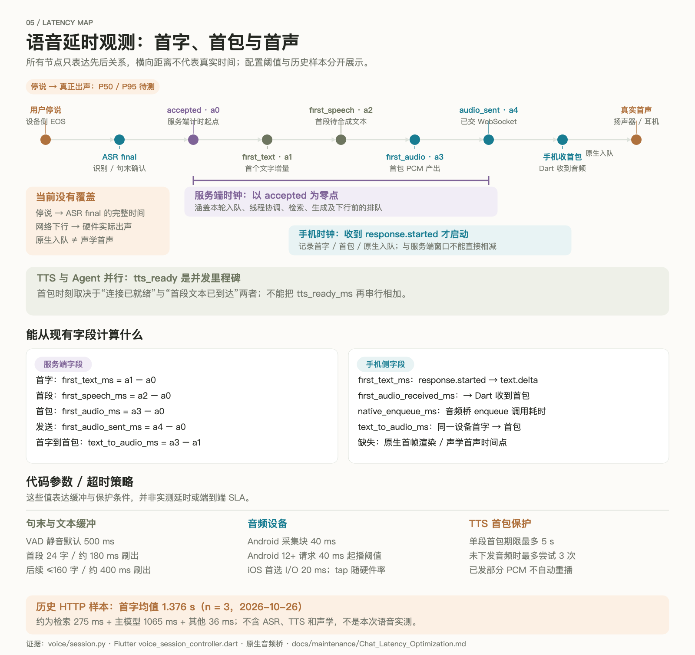

# 语音全链路、交互状态与延时分析

核验日期：2026-10-27。适用版本：后端 `ec78ed3`、Flutter `c43f095` 加各自当前工作区，移动协议 v1。阅读目标：明确用户从说话到识别、首字符、合成和播放的实际路径，并知道每个延时数字测到了哪里。

当前实时链路是 **Flutter 原生采集 → WebSocket → 百炼 ASR → Mem0/LangGraph → 分段 TTS → WebSocket → 手机原生播放**。Agent 与 TTS 连接并发准备，拿到短语即可合成，无需等全文或记忆提取结束。但目前还没有“用户停说到扬声器实际首声”的完整测量，所以端到端 P50/P95 仍待测。

## 一图看完整语音交互


图源：[可编辑 SVG](assets/04-voice-sequence.svg)。图的距离不代表实际耗时；ASR、模型和 TTS 都是独立调用，当前没有使用一个端到端语音大模型代替 Agent。

## 两个前端是两套语音路径

| 环节 | Flutter 实时入口 | Streamlit 录音入口 |
| --- | --- | --- |
| 用户输入 | 原生持续 PCM、离线唤醒、点击或文字 | `st.chat_input(accept_audio=True)` 提交完整录音 |
| ASR 调用方 | Python 后端异步实时 Provider | Streamlit Python 进程直接用同步 HTTP Provider |
| ASR 提交 | PCM 随说随传；partial字幕，final启动Agent | 完整文件Base64，`stream=False`；默认 `qwen3-asr-flash` |
| Agent 入口 | `VoiceConnection.generate()` 内部调用共享 runner | `AgentClient.astream()` → `/{agent}/stream` SSE |
| 回复显示 | `text.delta` 更新 Flutter 消息 | `draw_messages()` 更新占位文本 |
| TTS 起点 | 独立任务预连接；首个短语就能合成 | SSE读取结束后，对最后完整AI消息调用 `render_message()` |
| 音频返回 | 流式 PCM16/24k，下行二进制帧 | 整段HTTP合成，Base64或URL下载完整WAV，再显示播放器 |
| 播放确认 | 原生分段完成 → progress/finished → 后端保存 | 保存 `last_audio` 供 rerun 展示，没有相同的播放进度协议 |
| 插话 | 自动提示、手动暂停、显式取消、响应失效 | 未接入实时语音会话的上述插话协议 |

Streamlit TTS当前跳过少于3字符的文本，超过600字符截断；默认 `qwen3-tts-flash`，音色 Cherry。完整录音ASR最多7MiB，HTTP请求超时120秒。这些约束只属于文件/整段Provider，不能套到Flutter的分段实时链路。

证据：`src/streamlit_app.py::main`、`src/voice/manager.py`、`providers/alibaba_stt.py`、`providers/alibaba_tts.py`。Streamlit文字虽然流式，声音仍等待整轮流结束，其中可能包含记忆提取耗时。

## 建立会话：冷启动与持续会话分开看

Flutter首页根据能力接口选定Agent和音色。点击连接与唤醒最终都进入 `_connect()`：读取能力 → 校验协议和音色 → 麦克风权限 → `POST /voice/sessions` → 带Authorization的WebSocket → `session.configure` → 等待 `session.ready` → 原生音频切入conversation模式 → 开放实时上传。

`session.ready` 在上游ASR会话可用后才发，服务端首条控制事件必须在10秒内为 `session.configure`；客户端连接和等待ready分别有12秒超时。这些是错误保护，不是正常连接所需时间。

前台唤醒使用Sherpa ONNX 1.13.8，在独立Dart isolate中运行本地关键词模型；待机采集持续送给KWS并维护默认4秒预滚环形缓冲。命中“小美小美”后，复制预滚和建连期间音频，申明 `pre_roll_samples`，ready后补传，随后转为实时上传。4秒是最大保留窗口，不是每轮额外等待4秒。

后端默认用ASR二次确认唤醒词，允许跨final累计“小美”前缀；成功后剥离唤醒词并提交其后的有效命令。只有唤醒词没有任务时播放配置的欢迎语，不调用主模型、不形成普通用户对话。唤醒被拒绝或确认超时则关闭会话，终端回到待机。

初次打开还可能发生令牌恢复、能力获取、KWS模型素材准备与权限交互；这些不应混入已连接状态下每轮响应统计。当前只明确实现前台唤醒；不能据此声称锁屏、后台、蓝牙和来电矩阵全部验收。

## 手机麦克风到ASR

### 终端原生音频

| 平台 | 采集与处理 | 播放与完成回执 |
| --- | --- | --- |
| Android | `AudioRecord`，会话用 `VOICE_COMMUNICATION`，待机用 `VOICE_RECOGNITION`；16kHz/单声道/PCM16，1280字节读取块约40ms；按系统可用性启用AEC和降噪 | `AudioTrack`，24kHz/单声道流式输出；非阻塞写入，暂停或满缓冲保留余下PCM；通过真实playback head达到marker确认完整分段 |
| iOS | `AVAudioSession.playAndRecord/voiceChat`、Voice Processing；`AVAudioConverter`把设备输入变为16kHz PCM16；首选I/O buffer20ms，tap1920帧的时长随设备实际采样率变化 | `AVAudioPlayerNode.scheduleBuffer(...dataPlayedBack)`；统计pending buffer，真实播完后发segment/response完成 |

Android会话选择扬声器时保留合适的已有通信路由，停止时恢复原音频模式与路由。iOS允许Bluetooth HFP；支持API不代表所有设备AEC、延迟和音质都一致。`audio.metrics` 上报真实启用标志及RMS/峰值/削波汇总，不上报原始音频内容。

### 传输与帧

Dart的 `NativeAudioBridge` 通过 `agent_voice/microphone` EventChannel接收PCM，用 `encodeInputAudioFrame()` 封装，`VoiceSocket`发送。二进制帧是45字节大端头加小端PCM，魔数 `VCE1`，包含kind、connection UUID、response UUID、segment index、sequence；上行response为零UUID、segment为0，序号从0逐帧递增。

每帧payload最多6400字节，音频格式上行16kHz、下行24kHz、PCM16单声道。6400字节是上限，不是客户端固定分块大小；后端下行当前按不超过4096字节切片。服务端检查连接、序号、偶数字节和实时上传节奏，按申明预滚允许相应额外样本。

`receiver()` 放入有界 `audio_in`，`upload()`独立向ASR写入；`recognize()`同时读上游事件。默认server VAD要持续收到包括静音的音频才能判断结束。手动模式用 `input.commit`，该事件在server_vad模式会被拒绝。Flutter当前常规创建固定选择server_vad；后端协议也支持manual。

### 上游两种协议

`voice.catalog` 根据模型族或显式配置选择 `realtime/inference`。默认Settings是 `qwen3-asr-flash-realtime` 与 `qwen3-tts-flash-realtime`；部署可由Nacos覆盖，未读取线上值，不能据默认值断言当前账户实际用哪一个型号。

realtime路径发送 `session.update` 并等 `session.updated`；inference路径通过 `run-task/task-started/continue-task/finish-task` 翻译为统一业务事件。模型和音色目录绑定校验，换TTS模型后过期音色不能直接复用。当前支持多种适配模型族不等于每个供应商型号都已真机验证。

## ASR final到首字符

1. `speech_started/stopped` 转成 `input.started/ended`；partial转成字幕。partial不触发推测执行，所以不会因为识别修订重复操作工具。
2. final去重后过滤空白、标点和少数语气词；无效输入不建turn，不取消当前回答。正常句子保留标点。
3. 唤醒确认和前缀清理后进入 `submit()`，检查待确认业务、输入长度、持久去重和队列容量，再使上一回答失效。
4. 创建VoiceTurn，在 `accepted` 标记时间，然后保存turn、放入容量2的输入队列，发送 `input.accepted`。这就是后端语音指标的零点；它不包含之前的ASR和去重查询。
5. `worker.execute()`并发启动 `speak()`和 `generate()`。前者建立TTS连接并等文本，后者申请线程guard、构造输入、查checkpoint、处理业务确认并发送 `response.started`。
6. 共享 `graph_events()`运行Mem0。普通路径为邮件/记忆命令快速门控 → Mem0检索 → 主模型；需要模型识别的管理/邮件或工具分支会额外耗时。
7. 根正文token触发 `first_text`，追加 `generated_text`、发送 `text.delta`，再入TTS文本队列。`chatbot/mem0-chatbot`支持该流式模式；其他Agent默认等待根最终消息再播报。

研究、记忆意图等内部步骤带 `skip_stream` 或特定namespace，不把规划JSON和子图正文播给用户。主模型工具调用不等于首个用户可见正文；研究和视频分支应独立统计，不能套普通聊天均值。

## 首字符到TTS、首包与实际出声

`SpeechText`不等全文：首段遇可用句末边界、达到最多24字符，或待缓冲约180ms时尝试刷出；后续最多160字符、约400ms刷出。代码围栏、链接、Markdown标记和纯标点会被清洗；所以“首字”可能还不是可朗读内容。

这些阈值约束文本聚合，并不是严格的180ms首声保证。TTS连通性、任务启动、积压、队列背压和事件循环调度都可能增加时间。`speak()`先建连，再消费文本，文本可能已积压；断句计时从该消费过程的pending状态开始，不必与第一个模型token同时开始。

`first_speech` 标在首个可朗读短语从SpeechText产出时，随后才发送 `audio.segment.started` 并调用供应商合成，不能称为上游已经接受文本。`tts_ready` 在进入synthesizer上下文后标记：realtime已确认session；inference此时仅WebSocket连接就绪，每段的 `run-task/task-started`还在 `synthesize()` 内。

每段连续接收PCM，`emit_audio()`第一次处理PCM时标 `first_audio`；经过outgoing优先级队列并成功 `send_bytes()`后标 `first_audio_sent`。后者只是交给WebSocket，不是手机已收，也不是扬声器已出声。

客户端解码并过滤旧connection/response，通过MethodChannel入队原生播放器。Dart收到并完成首包enqueue后才进入speaking状态；Android 12+请求40ms的AudioTrack起播采样量，但这不是声学实测延时，系统、硬件路由、耳机和蓝牙还会影响播放。

## 播放完成、记忆完成和轮次完成

| 事件/状态 | 已完成什么 | 不能推出什么 |
| --- | --- | --- |
| `text.delta` | 根回答有可展示文本 | TTS已合成或用户已听见 |
| `audio.segment.done` | 后端这一段的PCM发送生产结束 | 手机已完整播放此段 |
| `response.done` | Agent执行和TTS任务结束并已保存turn | 播放设备已排空，也不等于邮件入箱或视频生成完成 |
| `playback.progress` | 终端确认完整分段的played samples | 任意半段内容都完整听到 |
| `playback.finished` | 原生端确认本次输出全部播放完成 | 真实环境中用户注意力/听觉一定接收到内容 |

Mem0在主回答之后等待事实提取。实时TTS已经获得正文时可以先播放，提取可能延后response.done；若提取失败也不丢掉已生成回答。语音turn的 `status/execution_status/audio_status`分别描述总状态、执行状态和合成状态，TTS失败时仍保留文字与已收到音频。

后端保存VoiceTurn的文本、分段、采样和播放确认，不保存原始PCM。`response.done.latency_ms`与连接内timings用于诊断，当前 `VoiceTurn` schema没有专用latency字段，因此不能假定 `/voice/.../turns`天然能返回完整历史延时统计。

## 插话与取消：三个动作的区别

| 触发 | 手机立即行为 | 后端判定 | 恢复/后续 |
| --- | --- | --- | --- |
| 自动能量VAD | 默认连续3个采集帧超过-42dBFS，发 `speech_hint(pausePlayback:false)`，不立即暂停 | ASR开始只发input.started；有效final被submit接受后才取消旧回答 | 未确认时约800ms发playback.resume；自动提示本来没有停播 |
| 点击“我要插话” | `speechHint()`立即暂停原生播放，保留缓冲 | 仍等待有效输入，不仅凭本地能量取消业务 | 服务端约800ms恢复提示，手机另有1秒兜底，前提是响应仍有效 |
| 点击停止/显式取消 | invalidResponses登记、原生cancel停播清缓冲，发response.cancel | 废弃旧音频/文本并标记interrupted；可取消的聊天任务被取消 | 等待下一轮；已提交外部操作不会假装回滚 |

Android原生取消会flush AudioTrack并重置写入/播放计数；iOS停止player并清理对应pending标记。服务端有urgent控制事件与invalid集合，客户端按connection_id、response_id继续丢弃迟到帧，因为已经进入TCP的旧包不能被撤回。

中断后下一轮 `delivery_context()`仅引用完整且确认播完的分段，避免模型把已生成但未听到的内容当成共同上下文。复杂Agent可能继续完成不可取消的业务；研究超时和Mem0同步worker也有各自的取消边界。

## 延时观测地图



图源：[可编辑 SVG](assets/05-voice-latency.svg)。目前覆盖中间窗口，首尾仍有缺口。所有数字须先声明时间起点和终点。

### 服务端已经有的指标

以 `a0=submit()标记accepted`，`a1=首正文`、`a2=首段可朗读文本`、`a3=首PCM进入下行生产`、`a4=首PCM成功交给WS`：

| 字段 | 公式/定义 | 包含与限制 |
| --- | --- | --- |
| `first_text_ms` | `1000 × (a1-a0)` | 含turn持久化、输入排队、线程协调、主Agent准备与首正文；不含ASR |
| `tts_ready_ms` | accepted到TTS连接上下文就绪 | 与Agent并发，不能再串行相加；协议ready含义有差异 |
| `first_speech_ms` | `1000 × (a2-a0)` | 已有首个清洗短语，尚不等于供应商已收到提交 |
| `first_audio_ms` | `1000 × (a3-a0)` | 首PCM到达后端下行生产；未含发送队列和手机侧 |
| `first_audio_sent_ms` | `1000 × (a4-a0)` | 包含outgoing等待与首包WS send；不含手机播放 |
| `text_to_audio_ms` | `1000 × (a3-a1)` | 综合文本聚合、连接等待和合成等；不是纯TTS模型推理时间 |

`first_speech_ms-first_text_ms`可近似观察首字到首个可朗读短语，`first_audio_ms-first_speech_ms`可观察首段准备后到PCM的等待，`first_audio_sent_ms-first_audio_ms`观察下行生产/队列/send；它们是实现边界差值，不是上游独立模型服务的纯耗时。

字段在 `response.done`被sender填入，缺失阶段不返回。若用户提前取消或连接断开，不能只用“完成响应”算延时分布，否则会漏掉慢请求和失败；欢迎语也应单列，否则会错误拉低模型首字统计。

### Flutter已经有的指标

Flutter的Stopwatch从收到 `response.started`开始，比服务端accepted更晚；两端同名 `first_text_ms`起点不同。`response.done`中的后端字段保存为 `server_*`，不能混合相减。

| 字段 | 起点 → 终点 |
| --- | --- |
| `first_text_ms` | 手机收到response.started → 收到text.delta |
| `first_audio_received_ms` | 同一手机起点 → Dart处理到首包音频 |
| `native_enqueue_ms` | 处理到首包 → MethodChannel enqueue返回；不含完整硬件排队 |
| `text_to_audio_ms` | 同一手机首字 → 首包被处理；受消息asyncMap处理队列影响 |

原生已有“分段播完”回执，但没有首个渲染采样/声学首声时间戳。当前调试输出和状态map也不是持久的P50/P95监控系统。需要保留response_id后收集事件，不能把当前页面一轮map当作历史数据库。

### 能写出的全链路公式

```text
用户停说 → 首字符
  = 停说到ASR final/submit接受 + 服务端 first_text_ms
    + 首文字下行与客户端呈现等待

用户停说 → 实际首声
  = 停说到ASR final/submit接受 + 服务端 first_audio_sent_ms
    + 音频下行 + Dart/原生队列 + 硬件/路由实际起播

用户开始说话 → 实际首声
  = 本次说话时长 + 上式；冷启动时还受会话就绪与预滚补传影响
```

这些项必须来自同一次请求的相同边界。服务端各阶段是相对accepted的累计时间，不能把first_text、first_speech、first_audio再彼此相加。TTS建连并行，首包取决于连接和文本两个分支何时同时可用。

## 已有数字：实测报告与配置分开展示

| 证据类别 | 数值 | 可以说明什么 |
| --- | --- | --- |
| 2026-10-26仓库已有HTTP合成请求报告，n=3 | 首正文1.432、1.337、1.359秒；均值1.376秒 | 当次完整HTTP首字，不含ASR/TTS/手机；本次没有复测 |
| 同一报告的分解 | 召回约275ms、主模型首正文约1065ms、其余约36ms | 当次样本的近似归因，非语音全链路与长期P95 |
| 代码默认 | VAD静音500ms | 服务端句末参数，非每轮ASR固定耗时；可由Nacos覆盖 |
| 代码缓冲 | 首段24字符/约180ms；后续160字符/约400ms | 文本刷出策略，非整体首声保证 |
| 设备请求参数 | Android采集块40ms；Android12+起播阈值请求40ms；iOS首选I/O20ms | 各平台音频参数，不能机械串成真实声学延时 |
| 超时保护 | 单段首PCM最多5秒或更短upstream预算；最多尝试3次 | 失败/重试策略；不是正常合成目标，也不能推出整轮一定15秒结束 |
| 端到端实测 | 停说→首声P50/P95：未获得 | 缺同轮端侧EOS、首渲染/声学观测和可比较采样 |

已有报告：[主对话首Token与缓存优化验证](../maintenance/Chat_Latency_Optimization.md)。它是当前工作区已有材料，本次只引用其说明，不读取真实用户或日志重新推导，也不把HTTP样本拼接为虚构的语音总延时。

TTS最多重试3次仅适用于尚未下发PCM的分段；已下发部分音频不自动重播。`InvalidParameter/InvalidApiKey/AccessDenied`不重试。建连、任务启动、各段持续合成与重试仍有其他预算，因此5秒不是整轮超时。

## 如何补齐端到端延时验收

以下是测量方案，尚未实现或执行，不能与上文已实现指标混淆。

1. 在同一手机单调时钟记录本地有效话音结束、首文字收到、首PCM收到、native enqueue、首次渲染与播放完成。原生首渲染也不是最终声学证据；用外部录音/回环进一步确认扬声器首声。
2. 后端保留response_id关联accepted、ASR final、安全的阶段耗时、模型调用和工具类型。设备EOS与ASR final不要跨设备绝对时间直接相减；优先同端观测或经过明确校时的trace方案。
3. 分组采样：冷启/已连接、普通/有记忆/研究/邮件/视频、realtime/inference、Android/iOS、扬声器/有线/蓝牙、网络RTT与抖动。欢迎语单独统计。
4. 每组建议至少100次合成请求，报告有效样本、超时、取消、失败比例与P50/P95；样本不足不输出稳定P95结论。不要自动产生真实邮件或视频副作用。
5. 用现有指标先定位：首字慢看检索/主模型/工具，首字到首包慢看分段/连接/供应商，服务端首包快而手机出声慢看网络/队列/AudioTrack或AVAudioPlayerNode。

当前最有价值的补齐点是终端EOS和首渲染/声学采样，以及按响应持久化指标。继续减小文本缓冲或直接换模型之前，应先得到这些分段证据；保持Mem0个性化、工具可靠性和插话语义也属于验收条件。

## 资源、重连与已知范围

连接内sender、receiver、upload、recognize、timer、worker并发；TTS与Agent另外有独立任务。后端音频/文本队列有界并保留背压，客户端的原生播放队列未看到时长硬上限，因此慢设备仍需监测积压，不能只证明后端有界就认为所有端都无积压。

session默认30分钟、空闲120秒、每进程连接容量默认8；用户会话数有保护逻辑，但SQL实际只统计特定状态，详见总览中的边界。JWT到期也会终止会话。重连创建新的语音传输状态并可复用thread，不自动重放旧音频或重新提交已发生业务。

本次完成源码与协议核验、图稿渲染和文档校验；没有连接手机、调用付费模型、发送邮件、生成视频或运行生产压测。相关替身测试已有并发首音、背压、重试、插话、记忆和研究链路断言，其位置见 [源码核验索引](Source_Map.md)。
